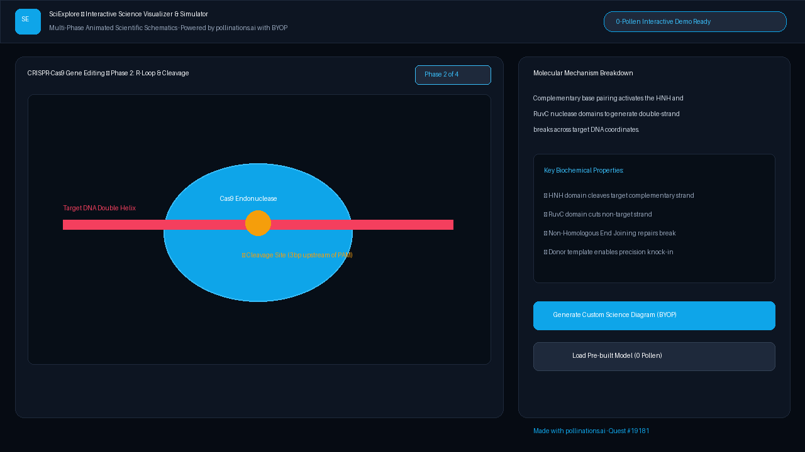

# SciExplore — Interactive Science Visualizer & Simulator

**Live App:** [https://brutus88ai.github.io/polli-sciexplore/](https://brutus88ai.github.io/polli-sciexplore/)  
**Quest:** [pollinations/pollinations#19181](https://github.com/pollinations/pollinations/issues/19181)

SciExplore transforms complex scientific concepts and mechanisms into interactive, multi-phase visual explorable simulations using **Pollinations**, featuring animated SVG schematics, phase-by-phase molecular breakdowns, and zero-pollen offline modes.

## Highlights

- **Multi-Phase Interactive Visualizations**: Inspect scientific mechanisms step-by-step (e.g. CRISPR-Cas9 endonuclease targeting and double-strand break repair).
- **Bring Your Own Pollen (BYOP)**: Native integration with `<polli-connect>` (@pollinations/ui).
- **0-Pollen Offline Schematics**: Pre-loaded with high-fidelity scientific models ready to explore without spending any Pollen.
